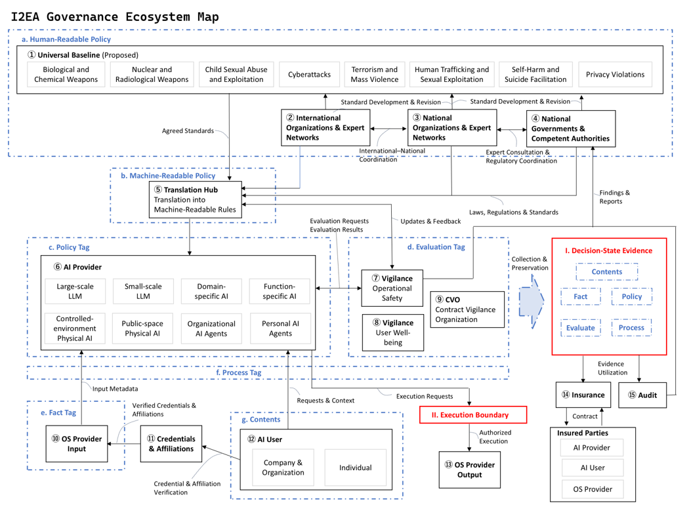
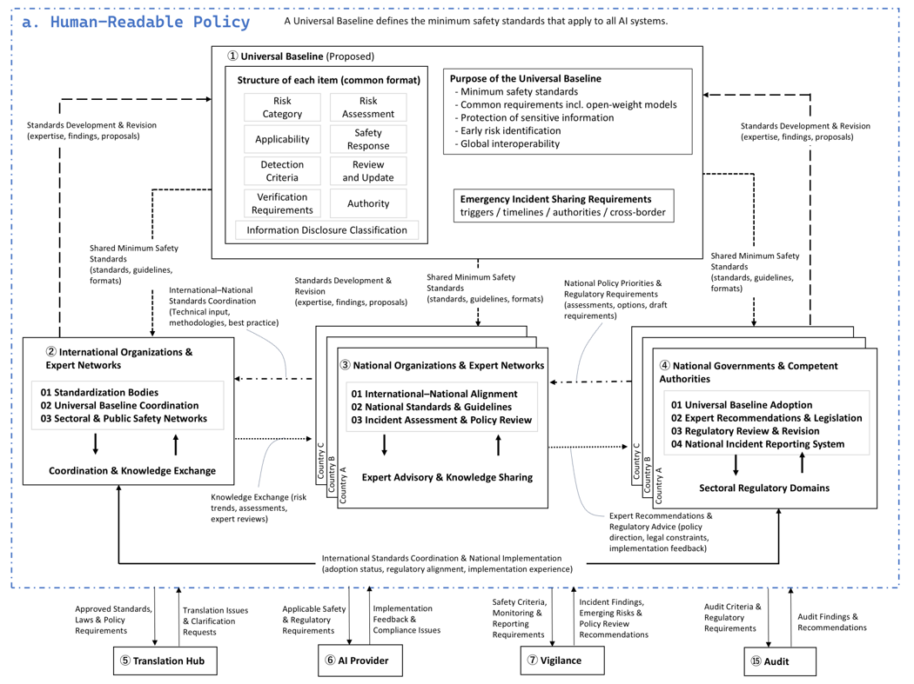
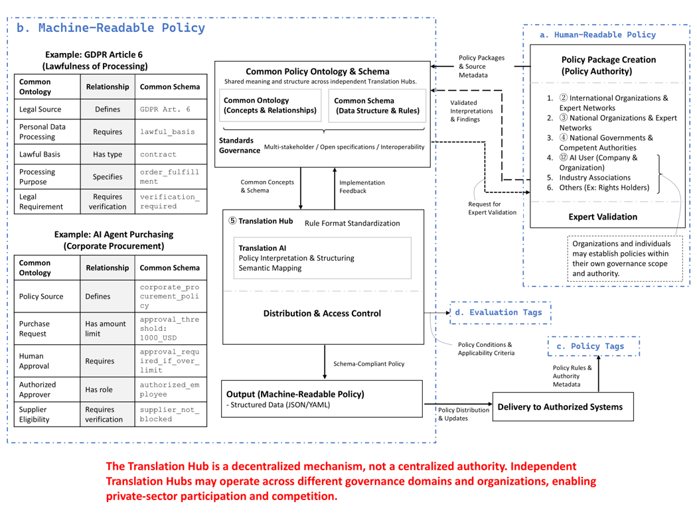

# I2EA AI Governance Ecosystem

**Institution-to-Execution Architecture (I2EA)**

A proposed shared infrastructure for interoperable AI governance, connecting institutions, policies, technologies, execution controls, and assurance.

## Overview

I2EA explores how human-defined governance requirements can be connected to machine-readable policies, operational decisions, execution controls, evidence, monitoring, and assurance.

The architecture is designed to support interoperability across organizations, jurisdictions, and technical systems without requiring all participants to adopt identical internal processes.

Together, the following three maps illustrate how the overall AI governance ecosystem connects human-readable policy development with machine-readable policy implementation.

## Governance Ecosystem Maps

| 01. Governance Ecosystem | 02. Human-Readable Policy | 03. Machine-Readable Policy |
|:---:|:---:|:---:|
|  |  |  |
| Overall governance architecture | Institutional policy development and coordination | Policy translation and operational implementation |

*Click any image to view the full-size map.*

## Project Status

These maps present a proposed conceptual architecture intended to support discussion, refinement, and further technical development.

**Published:** October 2026

## Author

**Mana Onishi**  
Independent Researcher, AI Governance

## I2EA Website

For more information about the architecture, its components, and related research, visit the official I2EA website.

**[Explore the I2EA Architecture](https://i2ea.org/architecture/v0.9/)**
