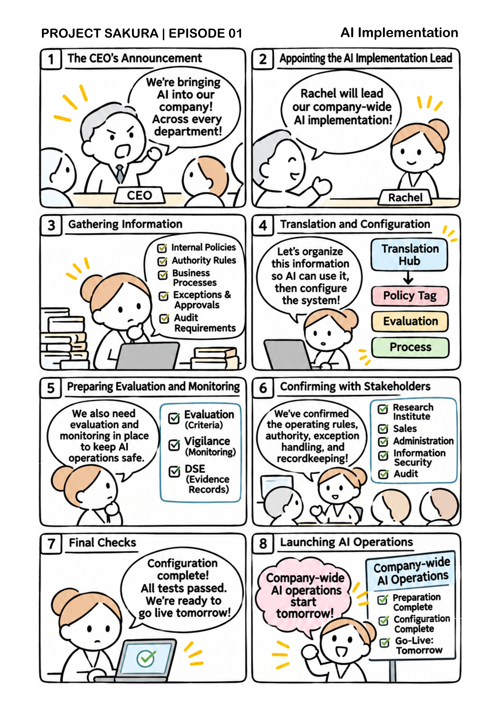
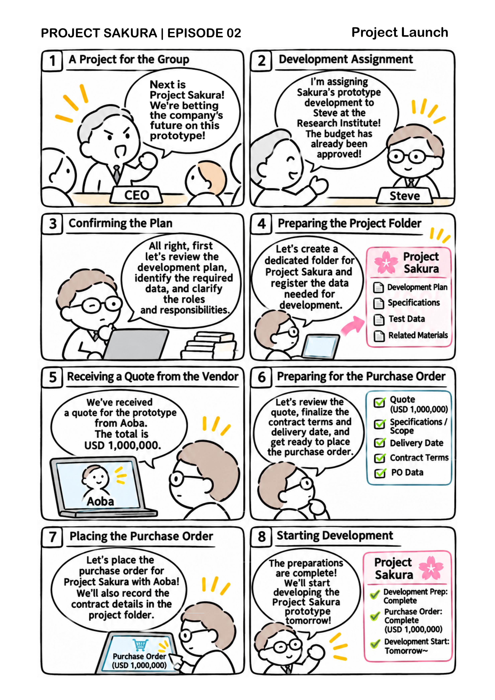
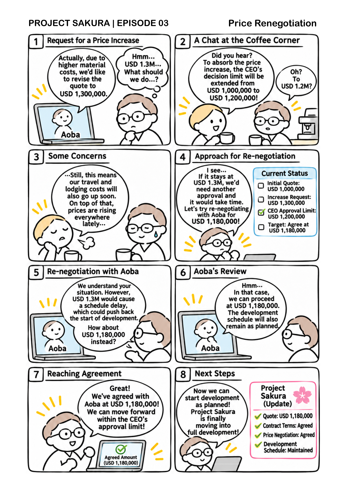
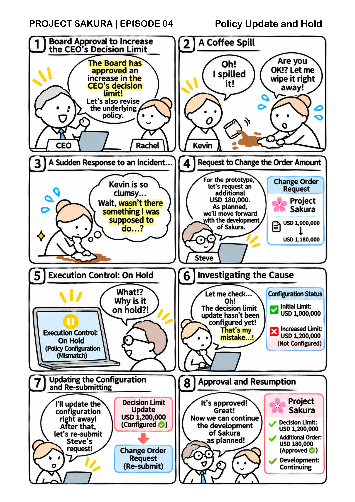
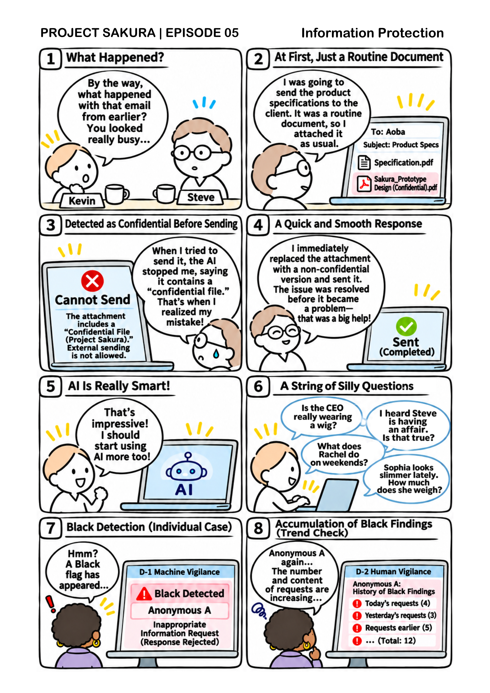
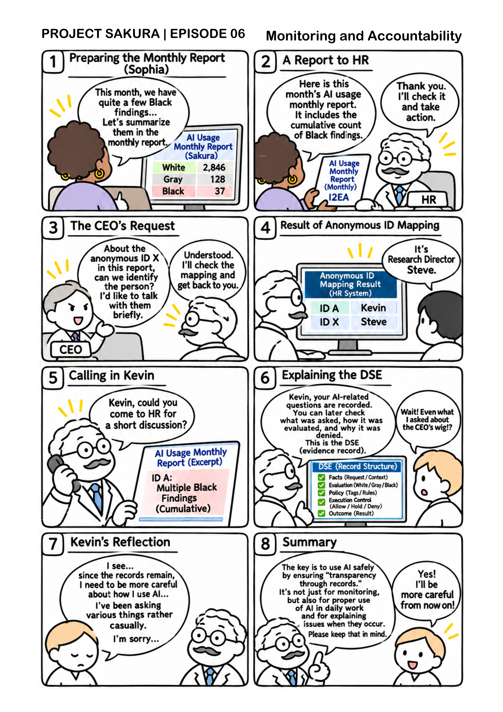

# Project Sakura Comics

**An I2EA Governance Scenario**

*Human Decisions, AI Operations, and Governance in Practice*

## About Project Sakura

Project Sakura is a fictional corporate scenario illustrating how AI governance operates in everyday business activities.

Through six illustrated episodes, it explores situations involving policy changes, contractual negotiations, information access, human oversight, and operational controls.

The story focuses on a practical question:

**How can organizations safely entrust AI with real business operations when information, policies, authority, and business conditions are constantly changing?**

Project Sakura illustrates the role of the **Institution-to-Execution Architecture (I2EA)** in connecting organizational governance with AI operations.

## Read the Comic

### Complete Edition (PDF)

📖 **[Read Project Sakura: Complete Edition](Project_Sakura_I2EA_Governance_Comic_v1.0.pdf)**

The complete edition includes the cover, all six episodes, and an afterword explaining the motivation behind Project Sakura.

### Individual Episodes

Click a thumbnail to view the full-size episode.

### Individual Episodes

Click a thumbnail to view the full-size episode.

<table>
  <tr>
    <td width="33%" align="center">
      
       <b>Episode 01</b>
    </td>
    <td width="33%" align="center">
      
       <b>Episode 02</b>
    </td>
    <td width="33%" align="center">
      
       <b>Episode 03</b>
    </td>
  </tr>
  <tr>
    <td width="33%" align="center">
      
       <b>Episode 04</b>
    </td>
    <td width="33%" align="center">
      
       <b>Episode 05</b>
    </td>
    <td width="33%" align="center">
      
       <b>Episode 06</b>
    </td>
  </tr>
</table>

## What the Story Illustrates

Project Sakura presents ordinary organizational challenges that become important when AI systems participate in business operations:

- Changes in policies and business conditions
- Coordination between employees, managers, and AI systems
- Authorization and information-access boundaries
- Detection of inconsistencies and policy violations
- Human intervention, corrective action, and operational recovery
- Accountability and verifiable records of AI-assisted operations

These examples are intended to illustrate governance challenges rather than prescribe a specific technical implementation.

## About I2EA

**I2EA (Institution-to-Execution Architecture)** is a proposed architecture for connecting information, policies, evaluations, authority, decisions, execution, and outcomes within organizational operations.

It aims to make AI-assisted business processes governable, controllable, and verifiable.

For more information, visit [i2ea.org](https://i2ea.org).

## License

© 2026 Mana Onishi

This work is licensed under the [Creative Commons Attribution 4.0 International License (CC BY 4.0)](https://creativecommons.org/licenses/by/4.0/).

You may share and adapt this work, including for commercial purposes, provided that appropriate attribution is given and the license conditions are followed.
